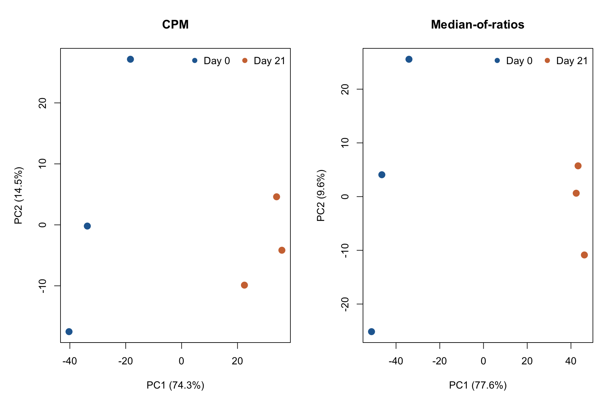

# Stem-cell osteogenesis: reproducible RNA-seq exploration in R

Author: Yelyzaveta Pushkarova

## Research question

How do transcriptomic profiles differ between day 0 and day 21 of osteogenic induction in human bone-marrow mesenchymal stromal/stem cells?

This is an exploratory secondary analysis of public data, not a new laboratory experiment or a validated biomarker study. No differential-expression tests were performed.

## Data

GEO accession: [GSE178679](https://www.ncbi.nlm.nih.gov/geo/query/acc.cgi?acc=GSE178679).

The count matrix used in this analysis is the **NCBI-generated** GRCh38.p13 gene-level count matrix, not the authors' supplementary count matrix. It contains 39,376 unique GeneIDs and six RNA-seq libraries. The annotation matches all count rows. The six additional miRNA libraries in the GEO series are excluded.

| Condition | GEO samples | Libraries |
|---|---|---|
| Day 0 | GSM5395968–GSM5395970 | 3 |
| Day 21 | GSM5395971–GSM5395973 | 3 |

**Three libraries per group does not establish three independent donors.** GEO metadata does not identify donors, biological independence, donor pairing or pooling assignments. Numeric suffixes are not evidence of pairing. Do not fit a donor-adjusted model or claim six independent people without supporting information. Time in culture is also confounded with the differentiation comparison.

## Run

1. Download this repository as a ZIP and extract it.
2. In the extracted project folder, create a `data` folder and a `raw` folder inside it (`data/raw/`).
3. Download these three files from the [GEO download page for GSE178679](https://www.ncbi.nlm.nih.gov/geo/download/?acc=GSE178679). Place them in `data/raw/` and rename them as shown below. Keep them compressed.

   | File on GEO | Save as |
   | --- | --- |
   | `GSE178679_raw_counts_GRCh38.p13_NCBI.tsv.gz` | `counts.tsv.gz` |
   | `Human.GRCh38.p13.annot.tsv.gz` | `annotation.tsv.gz` |
   | `GSE178679_series_matrix.txt.gz` | `series_matrix.txt.gz` |

4. Open `stemcell-osteogenesis.Rproj` in RStudio.
5. Run the command below in the RStudio Console:

```r
source("run_sensitivity.R")
```

The QC script uses base R only. It does not install packages or download files. It writes five descriptive figures, sample/gene QC tables, marker expression and `sessionInfo.txt` into `results/`.

## Methods fixed in advance

- Validate nonnegative integer counts, sample metadata and annotation matching.
- Report library sizes as **assigned counts**, not total reads or sequencing quality.
- Retain genes with CPM >= 1 in at least three libraries for descriptive distributions, PCA and correlations.
- Explore log2(CPM + 1); this is not a replacement for DESeq2 normalization.
- PCA uses the 500 most variable retained genes, centered and not variance-scaled.
- Pearson correlations use all retained genes on the same log scale.
- A preselected descriptive panel (RUNX2, SP7, ALPL, COL1A1, BGLAP, SPP1, IBSP) is not a list of discovered significant genes.
- No automatic sample exclusion, p-values, enrichment results or causal conclusions.

## Results and normalization sensitivity

All six libraries were retained. The ten most abundant genes accounted for 19.9–44.3% of assigned counts across libraries. The strongest pairwise correlation was between exp_2 and exp_3 (r = 0.979); the controls did not form a single separate branch in the correlation heatmap.

Median-of-ratios size factors were estimated using genes with positive counts in all six libraries. PCA used the same CPM-filtered gene pool in both analyses, selecting the 500 most variable genes separately for each transformation.

| Metric | log2(CPM + 1) | log2(size-factor normalized counts + 1) |
|---|---:|---:|
| PC1 variance explained | 74.3% | 77.6% |
| ALPL: day 21 minus day 0 | +3.12 | +3.11 |
| RUNX2: day 21 minus day 0 | +1.44 | +1.14 |
| SPP1: day 21 minus day 0 | -0.82 | -2.86 |
| COL1A1: day 21 minus day 0 | -1.11 | -1.48 |

The two groups separated along PC1 with both approaches. ALPL and RUNX2 had higher average normalized expression at day 21 under both transformations, while the size of the SPP1 difference depended on normalization. Marker differences are differences of group means on the respective transformed scales, not model-based log2 fold changes.




The sensitivity analysis was run successfully in RStudio. The script generates the QC figures, the PCA comparison (`06_pca_sensitivity.png`), and the numerical comparison tables.

## Limitations

These patterns describe the six deposited libraries. Unresolved donor pairing and replicate independence prevent a defensible confirmatory analysis. The day 0 versus day 21 contrast also cannot isolate differentiation from time in culture. No VST, p-values, adjusted p-values or enrichment tests are reported.

## Sources

- Xu et al. (2021), *Long Non-coding RNAs LOC100126784 and POM121L9P Derived From Bone Marrow Mesenchymal Stem Cells Enhance Osteogenic Differentiation via the miR-503-5p/SORBS1 Axis*. DOI: [10.3389/fcell.2021.723759](https://doi.org/10.3389/fcell.2021.723759).
- [NCBI RNA-seq counts documentation](https://www.ncbi.nlm.nih.gov/geo/info/rnaseqcounts.html).
- [DESeq2 vignette](https://bioconductor.org/packages/release/bioc/vignettes/DESeq2/inst/doc/DESeq2.html).

Publicly accessible data are attributed to their original creators; no new license over those data is asserted here.
